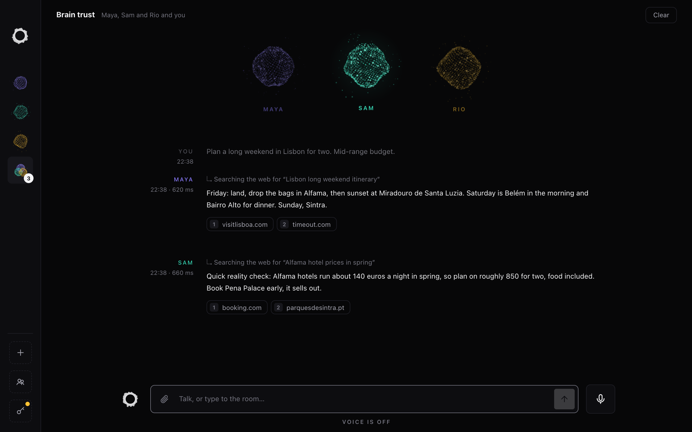
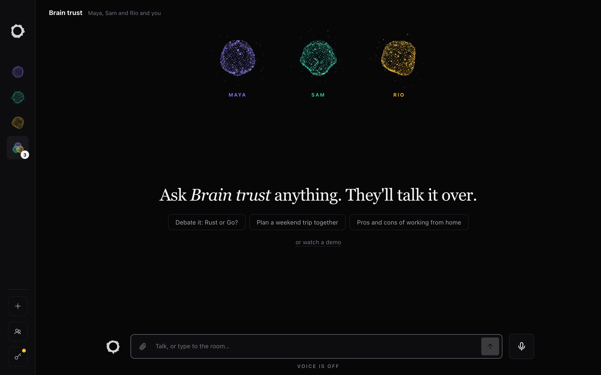

# Voxen

Your team of voices. Talk to one bot, or to a whole group of them, and they answer out loud,
each in its own voice, with its own personality and the AI model you pick for it.



- **Voice first.** Talk, talk over a bot to cut it off, or just type.
- **A team, not one chatbot.** Make as many bots as you like and put them in group chats, where
  they take turns and react to each other.
- **Any model for any bot.** 17 providers, from Claude, GPT, Gemini and Grok to a local model in
  Ollama. Switch a bot's model any time.
- **Bots that do things.** They search the web and show their sources, remember what you tell
  them, run tasks on a schedule, read your files and pictures, search X and make pictures.
- **Alive.** Every bot is a particle Orb that breathes, listens, thinks and speaks.
- **Yours.** Runs on your Mac with your own API keys. Memory, tasks and pictures stay in a local
  folder.

## Get started (about 10 minutes)

Voxen is built and tested on macOS. You need [Rust](https://rustup.rs), the Xcode command line
tools (`xcode-select --install`) and an API key for at least one AI provider.

1. Get the code and open the app. The first build takes a few minutes.

   ```bash
   git clone https://github.com/aniketshukla1/voxen.git
   cd voxen
   cargo run -p voxen
   ```

2. Paste your keys into the setup screen that opens. Voxen saves them to `.env` and restarts.
3. For voice, put headphones on (through speakers the bots hear themselves and stop). macOS asks
   for microphone access the first time.
4. Say "Maya, what's the capital of Japan?", then "Sam, what's 15% of 80?". Press Esc or click
   Stop to cut a bot off.

### Keys

| What for | Key | Get it at |
|---|---|---|
| Thinking (typing and voice) | One AI provider. Maya starts on Claude; click her to pick another. | [console.anthropic.com](https://console.anthropic.com) → API keys |
| Listening (voice) | Deepgram | [console.deepgram.com](https://console.deepgram.com) → API keys |
| Voices (voice) | ElevenLabs | [elevenlabs.io](https://elevenlabs.io) → Developers → API keys |
| X search and pictures (optional) | xAI | [console.x.ai](https://console.x.ai) → API keys |

You can also copy `.env.example` to `.env` and paste the keys there by hand. To check each key
on its own, run `cargo test -- --ignored`.

## Your bots

Maya is the main bot and Sam is a researcher. Make more bots and group chats with the + buttons
in the sidebar. In a group chat the bots take turns and react to each other. Everything is saved
in [team.toml](team.toml), which you can also edit by hand.



## Each bot thinks with the model you pick

Every bot can use a different provider and model: Anthropic Claude, OpenAI, Google Gemini,
xAI Grok, Mistral, DeepSeek, Perplexity, OpenRouter (hundreds of models), Groq, Together,
Fireworks, Cerebras, Moonshot Kimi, Alibaba Qwen, Ollama or LM Studio on your Mac, or any
OpenAI-compatible server. Pick it when you make a bot, or click a bot (or Change voice) to
switch it any time; the model list loads live from the provider. Add the provider's key in
Setup first. Web search works with Claude, OpenAI, Gemini, Grok and Perplexity; memory and
reminders work with every provider except Perplexity.

## What the bots can do

| Ask | What happens |
|---|---|
| "What's the weather in Lisbon tomorrow?" | Searches the web and reads pages; the sources show under the answer. |
| "Remember I'm vegetarian." | Every bot knows it in later chats. Saved in `data/memory.md`, which you can edit. |
| "Every 2 hours, check the Bitcoin price" / "Every weekday at 8, brief me on the news" / "Remind me at 6 to call Mum" | Each bot runs its own tasks on its own, at any interval (every few minutes, hours, days, weeks, months or weekdays), and answers out loud in its chat. Say "pause it", "make it every 3 hours", "what tasks do I have?" or "cancel it" to manage them. Saved in `data/tasks.json`. |
| Attach a picture, PDF or text file (button, drag or paste) | The bots look at it with your next message, typed or spoken. |
| "Compare these three laptops for me" | Like Grok, every reply decides how much to think and research: quick questions stay quick, hard ones get deep research. |
| "What are people on X saying about…" / "Make a picture of…" | Grok's X search and Grok Imagine. Needs an xAI key (optional, in Setup); pictures are saved in `data/pictures/`. |

## Privacy

- Your keys live in `.env` on your Mac and are never committed.
- Memory, tasks and pictures live in `data/`, which is never committed either.
- What you say goes only to the services you set up: Deepgram hears it, the bot's AI provider
  answers it, and ElevenLabs speaks the answer.

## How it's built

There are no vendor SDKs. `src/` is Voxen's own SDK: clients for every AI provider
(`src/llm.rs`) and for Deepgram, ElevenLabs and xAI, plus audio, turn-taking, the team, the
bots' tools (`src/tools.rs`) and the call engine (`src/call.rs`).

- `app/` is the Mac app (Tauri 2). Its window is plain HTML, CSS and JavaScript in `app/ui/`,
  with no build step.
- `src/main.rs` is a terminal version: `cargo run --release`.
- `cargo test` runs offline.

The plan is in [CAPABILITY-MAP.md](CAPABILITY-MAP.md) and the look in
[docs/brand-guidelines.md](docs/brand-guidelines.md). Voxen grows in small steps; each release is
in [CHANGELOG.md](CHANGELOG.md).

## License

[MIT](LICENSE)
